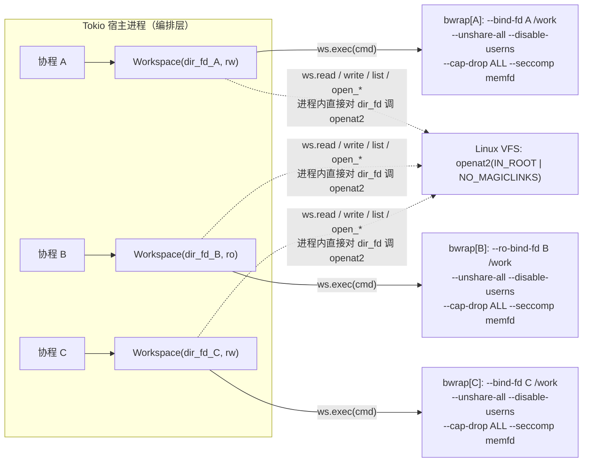

# Bubblewrap-coroutine-sandbox

用 **Bubblewrap（`bwrap`）** 为 Tokio 协程提供按目录隔离的权限控制（例如协程 A 只拥有目录 A 权限、协程 B 只拥有目录 B 权限、协程 C 只拥有目录 C 权限）。

---

## 核心问题与设计思路

Tokio 协程运行在同一个操作系统进程内，共享虚拟地址空间与文件描述符表，并且会在工作线程间迁移。Linux 内核和 `bwrap` 只能隔离**进程**，无法直接对同一个进程里的不同 `Future` 挂载不同的命名空间。

因此，用 Bubblewrap 实现协程权限控制需要做一层**能力抽象与平面拆分**：

1. **权限绑定在 `Workspace` 句柄上**：调度层通过 `Sandbox::workspace(dir, access)` 为协程 A、B、C 分别创建只绑定对应目录 inode（`O_DIRECTORY` fd）的 `Workspace` 句柄，而不是让协程随意拼接路径或直接启动子进程。
2. **执行隔离交给 Bubblewrap（`ws.exec`）**：当协程需要执行受限逻辑、第三方工具或外部脚本时，由对应 `Workspace` 拉起独立的 `bwrap` 沙箱进程：通过 `--bind-fd` / `--ro-bind-fd` 只将该协程获授权的目录挂到沙箱内的 `/work`，其他协程的目录（B/C）在挂载视图中根本不存在。
3. **纯路径文件读写走进程内 `openat2` 直通（工程取舍）**：当可信宿主协程仅需读写文件内容或列目录时，直接对同一个锁定的目录 fd 调用内核 `openat2(RESOLVE_IN_ROOT | RESOLVE_NO_MAGICLINKS)`，在路径防逃逸语义上与在 `bwrap` 子进程内再调一次 `openat2` 等价，同时省去常驻子进程与跨进程 IPC 开销。

### 威胁模型与边界（必须区分两种前提）

- **前提一：宿主 Rust 编排代码可信，受限对象是外部任务（`ws.exec`）与外部输入路径（本库定位）**
  - `ws.exec` 启动的任何程序均运行在独立 `bwrap` 容器中，物理上无法看到或访问其他协程的目录。
  - `ws.read` / `write` / `list` / `open_read` / `open_write` 传入的任何未清洗路径均由内核 `openat2` 锁死在目标目录 fd 内。
  - **不提供的保证**：若宿主进程内的 Rust 代码绕过 `Workspace` 直接调用 `std::fs`、`libc::open` 等宿主环境 API，因处于同一进程地址空间，内核不会拦截。
- **前提二：连协程函数体里的 Rust 代码本身也是不可信的**
  - 同进程原生协程无法防御恶意内存读写或直接系统调用。若需隔离执行逻辑本身，应将任务逻辑编译为独立可执行文件或脚本，由对应协程通过 `ws.exec(...)` 放进各自的 `bwrap` 沙箱内运行（或改用 Wasmtime + WASI preopen）。

---

## 架构



### Bubblewrap 隔离策略细节（`src/bwrap.rs`, `src/exec.rs`, `src/seccomp.rs`）

每次 `Workspace::exec` 启动的 `bwrap` 容器具备以下约束：

- **只挂载唯一业务目录（`--bind-fd` / `--ro-bind-fd`）**：挂载目标为授权时打开的目录 fd 而非路径字符串，即使父目录事后被改名或替换为符号链接，重建或再次启动沙箱时仍绑定原目录 inode；只读域由内核挂载层强制 `EROFS`。
- **最小根目录视图**：仅只读挂载 `/usr`（按宿主布局镜像 `/bin`、`/lib`、`/lib64` 等符号链接或目录），叠加独立的 `/proc`、`/dev` 与私有 `/tmp`，并 `--clearenv` 清空宿主环境变量。
- **全命名空间与能力收紧**：开启 `--unshare-all --unshare-user --disable-userns --cap-drop ALL --new-session --die-with-parent`，防止嵌套 userns 提权、root 宿主能力继承、`TIOCSTI` 终端注入与后台孤儿进程残留。
- **Seccomp 过滤（`--seccomp memfd`）**：通过只读密封的 `memfd` 向 `bwrap` 传入经典 cBPF 过滤器——校验宿主架构 `AUDIT_ARCH`、在 `x86_64` 上对 `__X32_SYSCALL_BIT`（`nr >= 0x4000_0000`）直接 `KILL_PROCESS`，并对 `bpf`、`io_uring_*`、`userfaultfd`、`keyctl`、`add_key`、`request_key`、`perf_event_open`、`kexec_load`、`kexec_file_load`、`open_by_handle_at`、`acct`、`swapon`、`swapoff` 返回 `EPERM`。
- **退出状态精准区分与输出上限短路**：通过 `--json-status-fd` 区分“`bwrap` 找不到/无法启动命令（返回 `io::Error`）”与“命令自身非零退出码”；`stdout`/`stderr` 共享 `Limits::max_payload` 原子预算，超限即 via `try_join!` + `child.kill().await` 立即斩杀整个沙箱（不等待超时）。

### 进程内数据平面与取消安全（`src/sandbox.rs`, `src/fs_ops.rs`）

- **句柄去重**：按 `(st_dev, st_ino, access)` 在存活 `Workspace` 间共享同一份目录 `OwnedFd`。
- **贯穿取消的资源所有权**：
  - `Workspace::exec` 在进入 `spawn_blocking` 前先 `try_clone()` 出独立目录 `OwnedFd` 并移入阻塞闭包，避免外层 Future 取消且最后一个 `Workspace` 销毁时发生描述符关闭后复用。
  - 文件操作（含流式 `SandboxReader` / `SandboxWriter` 的每步 64 KiB 分块 I/O、`seek`、`flush`、`commit`）按“单域 `max_in_flight` → 全局 `max_global_fs_in_flight`”顺序获取 `OwnedSemaphorePermit`，并在闭包内持有至系统调用完成，防止取消风暴击穿阻塞线程池上限。
- **原子写与流式接口**：`write` 与 `open_write` 在目标父目录创建 `.cs-tmp-*` 临时文件并通过 `renameat` 原子替换（`StagedFile` 守卫在取消或失败时同步 `unlinkat`，未做 `fsync`）；`SandboxReader` 保留 64 KiB 以内预读缓冲支持取消后换小缓冲区恢复读取，并通过独立 `meta_fd` 响应 `len()`；`open_read` 使用 `O_NONBLOCK` + `S_IFREG` 拦截 FIFO。
- **开发期防误用检查（`clippy.toml`）**：仓库内置 `clippy.toml` 用于在本仓库 CI 中检查示例代码是否直接调用 `std::fs` / `tokio::fs` / `Command`（非安全边界，普通 `cargo build` 不运行且不被下游依赖自动继承）。

---

## 用法：Tokio 协程 A/B/C 分别隔离到目录 A/B/C

```rust
use coroutine_sandbox::{Access, Limits, Sandbox};
use tokio::io::AsyncWriteExt;

#[tokio::main]
async fn main() -> std::io::Result<()> {
    let sandbox = Sandbox::new("bwrap", Limits::default())?;

    let ws_a = sandbox.workspace("/data/A", Access::ReadWrite)?;
    let ws_b = sandbox.workspace("/data/B", Access::ReadOnly)?;
    let ws_c = sandbox.workspace("/data/C", Access::ReadWrite)?;

    let task_a = tokio::spawn(async move {
        // 1. 跑在 A 的 bwrap 沙箱里：只能看到 /work -> /data/A
        let out = ws_a.exec("sh", ["-c", "ls /work; cat /data/B/secret.txt || true"]).await?;
        assert!(out.success());

        // 2. 进程内 openat2 文件读写同样被锁死在 A 内
        ws_a.write("note.txt", b"from A").await?;
        assert_eq!(ws_a.read("../B/secret.txt").await.unwrap_err().raw_os_error(), Some(libc::ENOENT));
        Ok::<_, std::io::Error>(())
    });

    let task_b = tokio::spawn(async move {
        // B 是只读权限：bwrap 内挂载为 --ro-bind-fd，任何写入均返回 EROFS
        let out = ws_b.exec("sh", ["-c", "touch /work/nope"]).await?;
        assert!(!out.success());
        Ok::<_, std::io::Error>(())
    });

    let task_c = tokio::spawn(async move {
        let mut w = ws_c.open_write("large.bin").await?;
        w.write_all(&vec![0xabu8; 1 << 20]).await?;
        w.commit().await
    });

    let (ra, rb, rc) = tokio::join!(task_a, task_b, task_c);
    ra.unwrap()?;
    rb.unwrap()?;
    rc.unwrap()?;
    Ok(())
}
```

---

## 构建与验证

环境要求：Linux 5.6+（支持 `openat2`），已安装 `bubblewrap`（需支持 `--bind-fd`、`--ro-bind-fd`、`--disable-userns`、`--seccomp`、`--json-status-fd`），并允许非特权 User Namespaces（或以 `root` 运行）。

```sh
# 一次执行 fmt、clippy 和全部单测/集成测试
BWRAP=/path/to/bwrap ./scripts/verify-linux.sh

# 运行示例与基准测试
BWRAP=/path/to/bwrap cargo run --release --example demo -- /tmp/demo-scratch
BWRAP=/path/to/bwrap cargo run --release --example bench -- /tmp/bench-scratch
```

---

## 基准参考

测试环境：Debian 12（Linux 6.1，16 核 x86_64，`nobody` 用户，Release 构建，`examples/bench.rs` 单次实测）：

| 操作 | 结果 | 说明 |
| :--- | :--- | :--- |
| 授权 100 个新目录域 + 首次小文件读 | p50 ~129 µs / p99 ~433 µs | 进程内 `openat2`，无常驻子进程 |
| 顺序 `ws.read`（5B 小文件，n=5000） | p50 ~34 µs / p99 ~149 µs | 含两级 `OwnedSemaphorePermit` + `spawn_blocking` |
| 1000 协程 × 20 次读（单域 / 100 域） | ~76k ops/s / ~70k ops/s | 受 `max_global_fs_in_flight = 64` 限流 |
| 64 MiB 流式写+提交 / 流式读 | 写 ~330 MiB/s / 读 ~373 MiB/s | 64 KiB 分块，每块受两级信号量与阻塞池调度 |
| `ws.exec("true")`（按次 `bwrap` + `seccomp`） | p50 ~16.8 ms / p99 ~24.3 ms | 每次新建独立 `bwrap` 命名空间、挂载表与过滤器 |

---

## 已知限制

- **无 Cgroup 资源配额**：非特权用户默认无权写入 `/sys/fs/cgroup`，`ws.exec` 仅限制墙钟超时与捕获输出字节数，未限制内存、CPU 或磁盘写入量；生产多租户场景建议在外层配合 `systemd-run --scope` 使用。
- **无细粒度网络代理**：`ws.exec` 固定开启 `--unshare-net`（仅保留回环设备 `lo`）。
- **Seccomp 为黑名单策略**：默认过滤器拦截常见高危内核接口，而非按特定业务定制的系统调用白名单。
